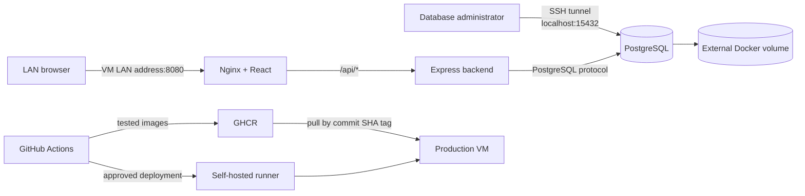

# TicketDesk

[](https://github.com/Rafattitas/company-ticket-lab/actions/workflows/pipeline.yml)

A self-hosted support-ticket system with a React dashboard, Express API, PostgreSQL storage, Docker quick start, and a production CI/CD reference implementation.

TicketDesk gives employees a simple request portal and gives IT a separate operational dashboard for triage, assignment, and resolution.

> This is a training environment. It demonstrates production practices, but it is not an approved production platform.

## Features

- Employee portal for submitting contact details, issue level, description, and an optional screenshot.
- Responsive IT dashboard with queue totals and urgent-work visibility.
- Ticket requester, email, phone, category, priority, assignee, and status tracking.
- JPG, PNG, and WebP attachments up to 5 MB, stored with the database backup.
- Password-protected IT dashboard with Admin, Agent, and Viewer roles.
- Search and filtering by status and priority.
- Automatic, idempotent PostgreSQL schema migrations.
- One-command local startup with Docker Compose.
- Health checks, persistent storage, non-root containers, and restricted capabilities.
- Tested container images, Trivy scanning, GHCR publishing, backups, and approval-controlled production deployment.

## Quick start

Requirements: Docker Engine with Docker Compose v2.

```bash
git clone https://github.com/Rafattitas/company-ticket-lab.git
cd company-ticket-lab
cp .env.example .env
docker compose --env-file .env -f compose.quickstart.yaml up --build -d
```

Open [http://localhost:8080](http://localhost:8080) for the employee portal and
[http://localhost:8080/admin](http://localhost:8080/admin) for the IT dashboard.
The first startup creates the database schema automatically.

Sign in to the IT dashboard the first time with username `admin` and password
`admin`. TicketDesk immediately requires a new password of at least 12
characters before it grants access to tickets or account management.

Check the services:

```bash
docker compose --env-file .env -f compose.quickstart.yaml ps
```

Stop the application while keeping its data:

```bash
docker compose --env-file .env -f compose.quickstart.yaml down
```

To delete the local database as well, add `--volumes` to the final command.

## Architecture



- Nginx serves the compiled React application and proxies `/api/` requests to the backend.
- The backend and PostgreSQL communicate on an internal Docker network.
- PostgreSQL also joins a dedicated management bridge so Docker can publish its
  administration port on VM loopback only; administrators reach it through an
  SSH tunnel.
- The frontend is published on the VM's configured LAN address on port `8080`.
- Devices on the same trusted LAN can open the application in a browser.

See [Architecture](docs/architecture.md) for the request flow, network boundaries, and persistent state.

## Repository tree

```text
company-ticket-lab/
├── .github/
│   ├── actionlint.yaml
│   └── workflows/
│       └── pipeline.yml
├── backend/
│   ├── migrations/
│   │   ├── 001_create_tickets.sql
│   │   ├── 002_ticket_workflow_fields.sql
│   │   ├── 003_requester_contact_and_attachments.sql
│   │   ├── 004_admin_accounts_and_sessions.sql
│   │   └── 005_require_password_change.sql
│   ├── routes/
│   │   └── tickets.js
│   ├── test/
│   │   └── tickets.test.js
│   ├── Dockerfile
│   ├── db.js
│   ├── migrate.js
│   └── server.js
├── deploy/
│   ├── postgres/
│   │   └── Dockerfile
│   ├── compose.yaml
│   ├── configure-readonly-user.sh
│   ├── host.env.example
│   ├── images.env.example
│   ├── integration-test.sh
│   ├── production-deploy.sh
│   ├── publish-images.sh
│   └── scan-images.sh
├── docs/
│   ├── architecture.md
│   ├── database-access.md
│   ├── deployment.md
│   ├── operations-runbook.md
│   └── security-scanning.md
├── frontend/
│   ├── public/
│   ├── src/
│   ├── Dockerfile
│   ├── nginx.conf
│   └── package.json
├── .gitattributes
├── .env.example
├── .gitignore
├── compose.quickstart.yaml
├── CONTRIBUTING.md
├── LICENSE
└── README.md
```

Generated directories such as `node_modules/` and `frontend/dist/` are intentionally excluded from Git.

## Components

| Component | Technology | Responsibility |
|---|---|---|
| Frontend | React, Vite, unprivileged Nginx | Serves the UI and reverse-proxies API requests |
| Backend | Node.js, Express, `pg` | Validates requests and provides the ticket API |
| Database | PostgreSQL 17 | Stores ticket data in an external volume |
| Orchestration | Docker Compose | Defines services, networks, secrets, limits, and health checks |
| Registry | GitHub Container Registry | Stores tested backend, frontend, and PostgreSQL images |
| Automation | GitHub Actions | Tests, builds, scans, publishes, and deploys releases |

## API

| Method | Path | Purpose |
|---|---|---|
| `GET` | `/health/live` | Process liveness |
| `GET` | `/health/ready` | Backend and database readiness |
| `GET` | `/api/tickets` | List the latest tickets |
| `GET` | `/api/tickets/:id` | Read one ticket |
| `GET` | `/api/tickets/:id/attachment` | Read the ticket image |
| `POST` | `/api/tickets` | Create a ticket |
| `PATCH` | `/api/tickets/:id/status` | Update a ticket status |
| `PATCH` | `/api/tickets/:id/assignment` | Assign or unassign a ticket |
| `POST` | `/api/auth/login` | Start an IT session |
| `POST` | `/api/auth/logout` | End the session |
| `POST` | `/api/auth/change-password` | Replace a temporary password |
| `GET` | `/api/auth/me` | Read the signed-in account |
| `GET/POST/PATCH` | `/api/auth/accounts` | Admin account management |

Allowed ticket states are `open`, `in_progress`, `resolved`, and `closed`.
Allowed priorities are `low`, `normal`, `high`, and `urgent`. The list endpoint accepts optional `search`, `status`, and `priority` query parameters.

The create endpoint requires `requester_name`, `requester_email`,
`requester_phone`, `title`, and `priority`. An optional `attachment` object may
contain a base64-encoded JPG, PNG, or WebP image up to 5 MB.

Listing, reading, and changing tickets requires an authenticated IT account.
Admins manage accounts, Agents read and update tickets, and Viewers have
read-only access. The initial production credentials are `admin` / `admin`.
The account cannot use the dashboard until that temporary password is changed.
New team accounts and administrator password resets follow the same forced
password-change flow.

## CI/CD pipeline

Pull requests run the verification stage only. A push to `main` runs the complete pipeline:

```text
verify
  ├── backend unit tests
  ├── frontend lint and build
  ├── container image builds
  ├── temporary PostgreSQL integration test
  └── Trivy vulnerability gate
        ↓
publish
  └── push the tested images to GHCR with sha-<commit> tags
        ↓
production approval
        ↓
deploy
  └── backup, pull, Compose update, health check, and rollback on failure
```

The production job runs on the `lab-prod` self-hosted runner and is protected by the GitHub `production` environment. Database passwords remain on the VM and are never stored in GitHub.

See [Deployment](docs/deployment.md) for the complete release flow and host layout.

## Security controls

- Base images and GitHub Actions are pinned to immutable digests or commit SHAs.
- Backend and frontend containers use read-only filesystems and drop all Linux capabilities.
- Privilege escalation is disabled with `no-new-privileges`.
- PostgreSQL and the backend are not published to the LAN.
- Database inspection uses a dedicated read-only role through an SSH tunnel.
- Secrets are stored under `/etc/company-ticket/secrets/`, outside Git.
- The deployment runner can invoke one root-owned deployment command only.
- Trivy reports HIGH and CRITICAL findings and blocks the configured fixable findings.
- A logical database backup is created and validated before every deployment.
- The deployment host retains the latest ten local backup sets.

See [Security scanning](docs/security-scanning.md) for the current Trivy gate and its documented exception.

## Operations

Common checks, logs, runner diagnostics, disk checks, and deployment troubleshooting are documented in the [Operations runbook](docs/operations-runbook.md).

Read-only database inspection from a workstation is documented in [Database access](docs/database-access.md).

## Development workflow

Changes are made on short-lived branches and merged through pull requests after the verification job succeeds. See [Contributing](CONTRIBUTING.md) for branch names, checks, commit guidance, and the rule against committing secrets.

## Current limitations

- Backups are stored locally on the VM; loss of the VM or its disk can remove both live data and backups.
- The lab uses one VM and one self-hosted deployment runner.
- Ticket history, email notifications, and service-level agreements are planned for later releases.
- Image tags include the Git commit SHA for traceability but remain registry tags; digest-based deployment would provide stronger immutability.
- The documented PostgreSQL `gosu` finding still requires a separate reachability review.

## License

TicketDesk is available under the [MIT License](LICENSE).
